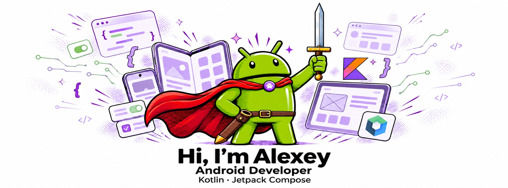

  <p align="center">
       
     </p>

  <p align="center">
    <a href="https://vk.com/fabledtria5">
      
    </a>
    <a href="https://hh.ru/resume/96755789ff0b54af7e0039ed1f3349516f4568">
      
    </a>
    <a href="https://x.com/fabled_tria5">
      
    </a>
    <a href="https://www.instagram.com/rogatin_alex/">
      
    </a>
    <a href="https://www.threads.com/@rogatin_alex">
      
    </a>
  </p>

  ---

  ### About Me

  I'm an Android Developer focused on building reliable, maintainable mobile applications with Kotlin and modern Android tools.

  - Working with production Android apps and feature development
  - Interested in Jetpack Compose, app architecture, UI state management and developer tooling
  - I care about readable code, predictable behavior and practical engineering decisions
  - Exploring mobile UX, Android internals and side projects

  ---

  ### Tech Stack

  #### Android

  <p>
    
    
    
    
    
  </p>

  #### App Architecture

  <p>
    
    
    
    
  </p>

  #### Build & Tooling

  <p>
    
    
    
    
    
    
  </p>

  **In production** · Built a referral program end to end, from aligning API contracts with backend engineers to implementing the Compose UI and writing tests.

  ---

  ### Side Project · Agentina

  A desktop workspace for working with Claude and Codex side by side. Built with Tauri and TypeScript, with local chat title generation powered by llama.cpp.

  <p>
    
    
    
    
    
  </p>

  ---

  ### Current Focus

  ```kotlin
  val currentFocus = listOf(
      "Building production Android features",
      "Improving UI architecture with Compose",
      "Writing maintainable Kotlin code",
      "Keeping app behavior predictable and testable"
  )
  ```
